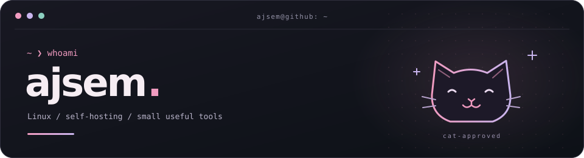

  

  IT support by day. Linux, self-hosting and side projects after hours. 
  Usually fixing something. Occasionally breaking it first. 🐈

  
  
  
  

  <a href="https://nakocloud.net">nakocloud.net ↗</a>

### Things I work on

- **Linux & self-hosting** — my desktop, services and whatever needs fixing next.
- **Useful little tools** — diagnostics, scripts and automating repetitive chores.
- **Web experiments** — building and tinkering with [nakocloud.net](https://nakocloud.net).
- **Off the keyboard** — games, cats and keeping an old Volvo alive.

### A few projects

| Project | What it does |
| :--- | :--- |
| [Steam License Cleanup](https://github.com/ajsem1337/Steam-License-Cleanup) | Review and remove unwanted free Steam licenses. |
| [System Health](https://github.com/ajsem1337/system-health) | A readable, read-only health report for CachyOS and Arch Linux. |
| [NetworkMaster](https://github.com/ajsem1337/NetworkManager) | Network diagnostics, scanning and monitoring. |

### Feeding the snake

<picture>
  <source media="(prefers-color-scheme: dark)" srcset="https://raw.githubusercontent.com/ajsem1337/ajsem1337/main/assets/github-snake-dark.svg" />
  <source media="(prefers-color-scheme: light)" srcset="https://raw.githubusercontent.com/ajsem1337/ajsem1337/main/assets/github-snake.svg" />
  
</picture>

Powered by curiosity, Linux and cats.

